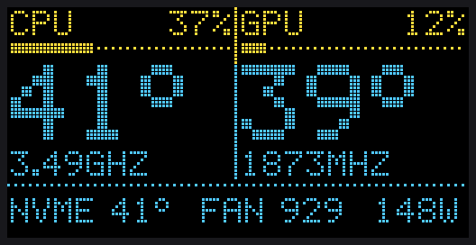
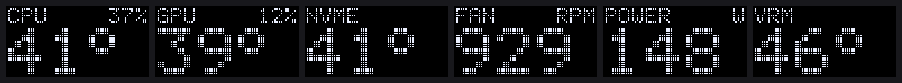
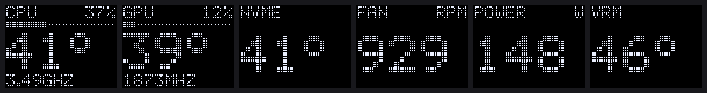
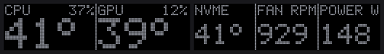
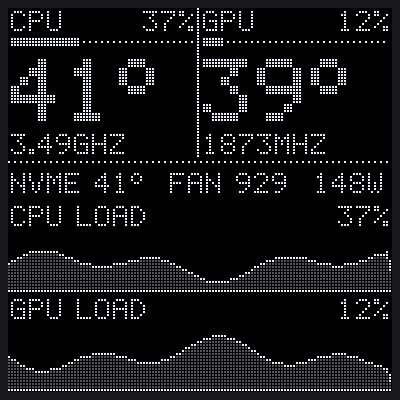
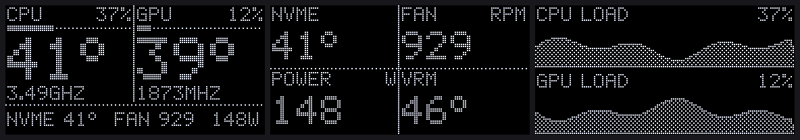

# bc250-oled

BC-250 stats on one of those tiny I2C OLED displays, wired straight to a header on the board. No USB and no
microcontroller: the board's own SMBus drives the display.



CPU and GPU temperature, load and clock, plus NVMe temperature, fan RPM, power and VRM temperature when the machine
has them. The layout adapts to the display's size, from 64x32 to 128x128:

| 0.49" 64x32 | 0.66" 64x48 | 0.91" 128x32 |
|---|---|---|
|  |  |  |

| 1.5" 128x128 greyscale | 0.96"/1.3" 128x64, all pages (`--pages overview,system,graphs`) |
|---|---|
|  |  |

> **Status: early.** It runs against emulated displays (see [tests](tests/test_basic.py)); the first test on a real
> BC-250 is still to come. Issues and photos welcome.

## Supported displays

Any I2C OLED module with one of the common controllers. Pick the preset that matches yours:

| Module | Pixels | Controller | Preset |
|---|---|---|---|
| 0.49" | 64x32 | SSD1306 | `--preset 0.49` |
| 0.66" | 64x48 | SSD1306 | `--preset 0.66` |
| 0.91" | 128x32 | SSD1306 | `--preset 0.91` |
| **0.96"** (white, blue, or yellow/blue) | 128x64 | SSD1306 / SSD1315 | default |
| 1.3" | 128x64 | SH1106 | `--preset 1.3` |
| 1.5" greyscale | 128x128 | SSD1327 | `--preset 1.5` |
| 1.5" | 128x128 | SH1107 | `--preset 1.5-sh1107` |
| 1.54", 2.42" | 128x64 | SSD1309 | `--preset 1.54` / `--preset 2.42` |

Anything else [luma.oled](https://github.com/rm-hull/luma.oled) knows works with `--driver` and `--size`, for
example `--driver ssd1305 --size 128x32` or `--driver sh1107 --size 64x128`. `python -m bc250_oled displays` lists
them all.

Not sure what you have? The listing usually says. A 1.3" that shows a picture shifted by 2 pixels with a stripe of
noise on one side is an SSD1306 sold as SH1106 (or the other way round): try the other driver.

Get the **I2C** version (4 pins: GND, VCC, SCL, SDA). The 7-pin SPI version won't work on these headers.

## How to connect

The display goes on the **TPMS1** header, in the lower-left corner of the board (near the `SPEAKER1` and `J4004`
headers). It carries the board's main SMBus and a 3.3 V supply that's on while the board runs.

### What you need

- The display, I2C version.
- 4 female-to-female jumper wires with a **2.0 mm** connector on the board side. TPMS1 has 2.0 mm pitch, not the
  usual 2.54 mm: standard Dupont jumpers are too wide to sit side by side. Use 2.0 mm jumpers, a 2.0 mm to 2.54 mm
  adapter cable, or solder.
- A multimeter, to check the pins before plugging the display in.

### Pins

| Display pin | TPMS1 pin | Signal on the board |
|---|---|---|
| GND | 2 (or 12, 17, 18) | ground |
| VCC | 9 | 3V: 3.3 V, on while the board runs |
| SCL | 4 | SMB_CLK_MAIN |
| SDA | 6 | SMB_DATA_MAIN |

```
TPMS1 (2.0 mm pitch), pin numbers as on the board's documentation; find pin 1 on yours first

        odd pins   1   3   5   7   9  11  13  15  17
                               [VCC]
        even pins  2   4   6   8  10  12  14  16  18
                 [GND][SCL][SDA]
```

> [!WARNING]
> - **3.3 V only.** Never take VCC from a 5 V pin. The display module has pull-up resistors from SCL and SDA to its
>   VCC: on 5 V they would put 5 V on the board's SMBus, which is a 3.3 V bus shared with other chips.
> - The pinout comes from community documentation (credited below), confirmed in practice by a user who wired a
>   128x64 display to TPMS1's SDA and SCL. Your board revision could differ: **measure before you connect**.

### Check with the multimeter (board on, display not connected)

1. Find pin 1: a square pad, a triangle or a "1" in the silkscreen next to the header. Pins are numbered in pairs:
   1 and 2 face each other, then 3 and 4, and so on.
2. Black probe on a ground (a metal screw hole, or the PSU connector's black wire).
3. Pin 2: 0 V. Pin 9: **3.3 V**.
4. Pins 4 and 6 (SCL and SDA) idle high: about **3.3 V** as well. If anything reads 5 V, stop and check the pin
   numbering again.

Then power off, connect the four wires, and power on.

### Check from Linux

```bash
bash setup.sh
```

The installer looks for the display and lists every I2C bus, for example:

```
  i2c-1   SMBus PIIX4 adapter port 0 at 0b00            display at 0x3C (answers quick), byte writes
  i2c-2   SMBus PIIX4 adapter port 2 at 0b00            -
  i2c-3   AMDGPU DM i2c hw bus 0                         -
```

You can run that check on its own at any time:

```bash
.venv/bin/python -m bc250_oled detect
```

**No data sent:** the check only knocks at `0x3C` and `0x3D`, the two display addresses. It tries a one-byte read
first. Many modules ignore reads, so it then sends the address alone with no data (an SMBus "quick write", what
`i2cdetect` does at these addresses). The program never writes to any other address. Some modules have the address
printed as `0x78`/`0x7A`: those are the same two addresses, written the 8-bit way.

The display isn't found?

- Run `bash setup.sh` again: it sets up the I2C driver and access the first time.
- SCL and SDA swapped is the most common mistake. Swapping them back is harmless.
- Some modules have a solder jumper for the address; both addresses are searched.
- The display only gets power while the board runs. 3V is not the standby rail.

Found, but the screen stays dark? Stop the service and run the step-by-step test. It shows an all-white screen, a
frame with a cross, then the stats, timing each one, and asks you to unplug and replug the display to check it comes
back:

```bash
systemctl --user stop bc250-oled
.venv/bin/python -m bc250_oled test          # add your --preset / --driver if not a 0.96"
systemctl --user start bc250-oled
```

- All white works but nothing else does: send the output in an issue.
- Nothing at all, though the test runs without errors: the module may use another controller. Try `--preset 1.3`
  (SH1106).
- A picture shifted by 2 pixels with noise on one edge: wrong driver, try the other one.

**Unplugged and plugged back?** The display comes back blank, and writes to it still succeed, so the program can't
tell it happened. Every 10 seconds it sets the display up again and resends the picture (`--keepalive`), so it
recovers by itself within 10 seconds. Waking a display that never lost power doesn't make it blink.

**Byte writes:** the chipset SMBus can only send a byte at a time, so a full 128x64 picture takes a good part of a
second. To keep up, the program sends only the bytes that changed since the last picture, usually a few digits. On a
bus that can do proper I2C transfers it uses them automatically.

### Not TPMS1

- **I2C_HEADER1** (3 pins: SCL, SDA, GND) is the PMBus to the board's voltage regulators. Don't put a display there:
  it has no power pin, and that bus sets the CPU and GPU voltages.
- **USB instead:** an MCP2221A USB-to-I2C board on a USB port shows up as an I2C bus (Linux `hid-mcp2221` driver).
  `detect` finds the display on it like on any other bus, with no soldering or header wiring.

## Install

On the BC-250:

```bash
git clone https://github.com/raphaeltournafond/bc250-oled ~/bc250-oled
bash ~/bc250-oled/setup.sh
```

What setup does:

1. Installs the Python libraries in `~/bc250-oled/.venv`, private to this folder.
2. Asks before each system change:
   - loads `i2c-dev` at boot;
   - adds a udev rule so your account can open `/dev/i2c-*` (your own group, no extra group needed).
3. Looks for the display.
4. Starts a systemd user service at boot, which keeps retrying until a display answers.

It works on Bazzite, CachyOS, SteamOS and other systemd distros.

Options are remembered between runs:

```bash
bash setup.sh --preset 1.3 --rotate 180 --night 23:00-07:30
```

| Option | Default | Effect |
|---|---|---|
| `--preset NAME` | 0.96 | the display (table above) |
| `--driver`, `--size WxH` | | override the preset's controller / size |
| `--rotate 0/90/180/270` | 0 | for a display mounted upside down or on its side |
| `--pages overview,system,graphs` | depends on size | screens shown in turn, `--page-seconds` each (6) |
| `--contrast 0-255` | controller's | lower is dimmer and wears the OLED less |
| `--night HH:MM-HH:MM` | | display off during these hours |
| `--alert °C` | 90 | a temperature at or above this shows inverted |
| `--bus N`, `--address 0x3C` | auto | skip the search |
| `--no-shift` | | the picture moves by one pixel every 3 minutes against burn-in; this turns it off |
| `--keepalive S` | 10 | seconds between setting the display up again, so it recovers after being replugged; 0 turns it off |
| `--fan` | | (setup only) loads the Super I/O sensor driver for fan RPM and VRM temperature |

Commands:

| What | Command |
|---|---|
| Log | `journalctl --user -u bc250-oled -f` |
| Update | `git -C ~/bc250-oled pull && bash ~/bc250-oled/setup.sh` |
| Remove | `bash ~/bc250-oled/setup.sh --uninstall` |

### Try layouts without a display

```bash
.venv/bin/python -m bc250_oled preview --preset 0.91 --pages overview,system,graphs --out preview.png
.venv/bin/python -m bc250_oled preview --live --tint yellow-blue    # this machine's readings
```

This works on any computer, Windows included:

```bash
pip install -r requirements.txt
python -m bc250_oled preview
```

## Where the numbers come from

Everything is read from `/sys` and `/proc`. Nothing needs root, and nothing is written.

| Shown | Source |
|---|---|
| CPU temperature, clock, load | `k10temp`, cpufreq, `/proc/stat` |
| GPU temperature, clock, power | `amdgpu` hwmon |
| GPU load | the graphics engine time of the programs using the GPU (`/proc/*/fdinfo`, as nvtop does). The BC-250 has no `gpu_busy_percent`. Only your own programs are visible, so the service runs as you. |
| NVMe temperature | `nvme` hwmon |
| Fan RPM, VRM temperature | the Nuvoton Super I/O (`nct6683` with `force=1`, or `nct6687`), with `--fan` |

Missing values show `--`, and the system page only shows the readings this machine has.

## Development

```bash
python -m unittest discover -s tests -v     # layouts for every size, sensors on a fake sysfs, emulated displays
python tools/make_previews.py               # the pictures in docs/
```

The display tests run an emulated SSD1306 and SH1106 that keep their picture memory. They feed it through raw I2C,
SMBus block and byte-at-a-time writes, and check that every partial update leaves exactly the intended picture.

## Credits

- Pinouts and board details:
  - [elektricM/amd-bc250-docs](https://github.com/elektricM/amd-bc250-docs)
  - [mothenjoyer69/bc250-documentation](https://github.com/mothenjoyer69/bc250-documentation)
- The idea, and the confirmation that TPMS1's SMBus drives a 128x64 OLED:
  [NexGen 3D Printing SteamMachine discussion #105](https://github.com/NexGen-3D-Printing/SteamMachine/discussions/105)
  and its community.
- Display drivers: [luma.oled](https://github.com/rm-hull/luma.oled).

MIT license.
